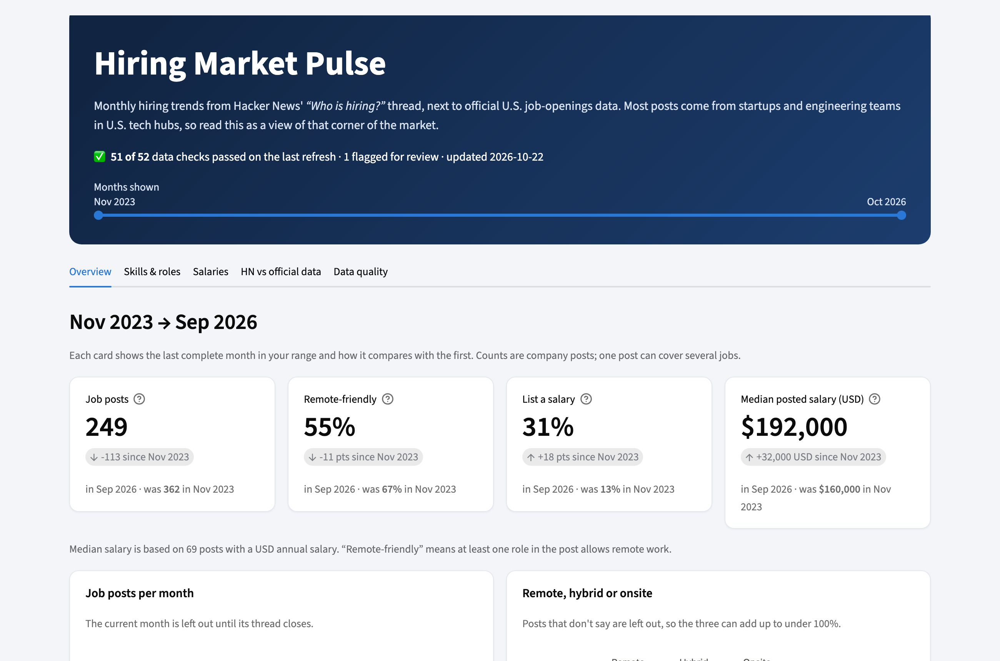
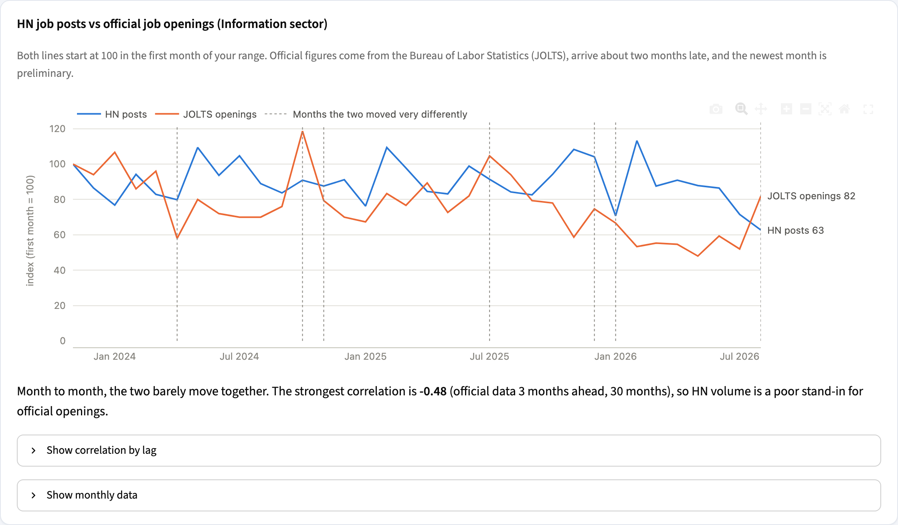
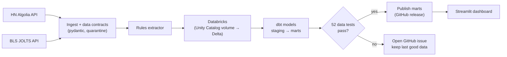
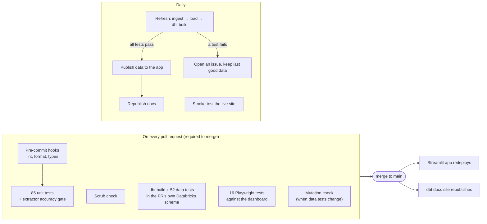

# Hiring Market Pulse

[](https://github.com/wacsvn/hiring-market-pulse/actions/workflows/ci.yml)
[](https://github.com/wacsvn/hiring-market-pulse/actions/workflows/refresh.yml)
[](https://github.com/wacsvn/hiring-market-pulse/actions/workflows/docs.yml)
[](https://github.com/wacsvn/hiring-market-pulse/actions/workflows/live-smoke.yml)

**[Live dashboard](https://hiring-market-pulse.streamlit.app/)** ·
**[Data model docs](https://wacsvn.github.io/hiring-market-pulse/)** ·
[Case study: tests that couldn't fail](docs/case-studies/tests-that-couldnt-fail.md) ·

> **In short:** a daily pipeline loads 11,500+ job posts and official labor data into
> Databricks, models them with dbt, and publishes a dashboard only after 52 data tests
> pass. The tests are themselves tested (11/11 injected faults caught), and the
> free-text extraction is scored against hand-checked posts (work mode 98% accurate).

A tested data pipeline and dashboard built on three years of Hacker News' monthly
**"Who is hiring?"** threads (11,500+ company posts). It tracks how those companies hire
(remote work, pay transparency, skills) and compares their activity with official U.S.
job-openings data (BLS JOLTS).

**Who this covers:** companies that choose to post in the thread. They are mostly
startups, engineering-heavy, and concentrated in U.S. tech hubs, and one post often
covers several roles. Treat the numbers as trends within that slice of the market, not
as figures for tech jobs overall.

The point of the project is less the charts than the machinery behind them: data
contracts at the door, 52 automated data tests, and a mutation check that proves those
tests actually catch bad data. Publishing is gated, so nothing reaches the dashboard
unless every hard check passes.



## What the data says

Comparing November 2023 with September 2026 (the latest complete month). The changes
over time are more reliable than the levels, because the population stays the same kind
of company from month to month.

- **Pay transparency more than doubled.** 13% of posts listed a salary, now 31%.
  Among posts with a USD annual range (69 in September 2026), the median midpoint went
  from $160k to $192k. That level sits well above typical U.S. software pay (BLS median
  for software developers was about $132k in 2023) because these are mostly senior,
  engineering, and high-cost-market roles, and pay-transparency laws make high-pay states
  the most likely to post ranges.
- **Remote is giving ground, slowly.** Posts where at least one role allows remote
  work fell from 67% to 55%, while onsite-only rose from 15% to 25%. HN startups are far
  more remote-friendly than the job market as a whole. (The accuracy audit below found
  these levels had been understated by about 5 points; the downward trend held.)
- **AI is the fastest-rising skill mention.** Posts mentioning LLMs/GenAI went from 8% to
  15% (first vs last six months). Postgres, TypeScript and Python also climbed; Vue,
  Django and C++ declined.
- **HN is not a stand-in for the official numbers.** Over the same window, BLS job
  openings in the Information sector fell 35% (first vs last six months), while HN post
  volume fell only 6%. Month-to-month the two are weakly related (|r| < 0.5 at every lag
  from -3 to +3 months), so HN reads as a view of startup and engineering demand, not of
  the sector as a whole.



## How it works



1. **Ingest:** `pulse ingest` pulls each monthly thread and the JOLTS series. Every
   record is validated against a [pydantic contract](src/pulse/contracts.py); failures
   go to a quarantine table with the reason instead of disappearing.
2. **Extract:** a deterministic [rules extractor](src/pulse/extract/rules.py) pulls work
   mode, salary, role, seniority, location, and tech stack out of free-text posts.
3. **Load:** parquet goes to a Databricks volume and becomes Delta tables
   (`read_files`), with schema-drift capture.
4. **Model:** [dbt](dbt/models) builds staging views and marts: monthly KPIs, role mix,
   tech trends, salary bands, and the HN-vs-JOLTS comparison.
5. **Test and publish:** the daily [refresh workflow](.github/workflows/refresh.yml)
   publishes the marts only if `dbt build` passes; otherwise it opens an issue.
6. **Present:** the [Streamlit app](app/streamlit_app.py) reads the published marts and
   shows its own data-quality status ("51 of 52 checks passed").
7. **Document:** every model and column is described in dbt, published as a
   [searchable docs site](https://wacsvn.github.io/hiring-market-pulse/) with lineage
   and the tests on each column.

## How quality is enforced

| Layer | What runs | Where |
|---|---|---|
| Inputs | Data contracts on every record; quarantine with reasons; quarantine-rate limit | [`contracts.py`](src/pulse/contracts.py), [dbt test](dbt/tests/assert_quarantine_rate_below_5pct.sql) |
| Python | 85 pytest tests on recorded API responses, incl. property-based salary parsing | [`tests/`](tests) |
| Field extraction | Accuracy audit on 50 sampled posts, scored per field; CI fails if any field drops more than 2 points below the committed baseline | [`evals/`](evals) |
| Data | 52 dbt tests: uniqueness, relationships, accepted values, salary rules, no missing months, freshness, schema drift, cross-source divergence (warn) | [`dbt/`](dbt) |
| Data tests themselves | Mutation check: corrupts a copy of the data 11 ways; each matching test must fail (11/11) | [`dbt_mutation_check.py`](scripts/dbt_mutation_check.py) |
| Dashboard | 16 Playwright tests against frozen fixture data: KPIs following the date range, sample-size warnings, chart contents, color stability, empty and unreachable-data states | [`e2e/`](e2e) |
| Deployed app | Daily smoke test of the live site after each refresh | [`live-smoke.yml`](.github/workflows/live-smoke.yml) |
| CI/CD | Every PR must pass all checks before it can merge; see below | [`.github/workflows/`](.github/workflows) |

### Accuracy audit of the extracted fields

Data tests check that the tables are internally consistent. They can't tell you whether
"remote" was read correctly from a free-text post. For that, 50 recent posts were drawn
at random (stratified so salary and remote cases appear), labeled field by field, and
the extractor was scored against the labels ([`evals/`](evals)).

| Field | Before audit | After fixes |
|---|---|---|
| Work mode (remote / hybrid / onsite) | 91% | 98% |
| Salary found when present, absent when not | 98% | 98% |
| Salary values correct | 93% | 93% |
| Seniority | 70% | 91% |
| Role families exactly right | 70% | 70% |

What it found:

- **A definition bug.** The dashboard defines "remote-friendly" as *any role allows remote*,
  but the extractor checked "hybrid" first, so "Hybrid or Remote (US)" counted as hybrid.
  Fixed; remote levels rose about 5 points, and the trend was unchanged.
- **Seniority lived in the body, not the header.** Many posts name roles ("Senior Software
  Engineer") below the first line. The extractor now reads job titles from the opening of
  the body, while ignoring prose like "our senior leadership".
- **8% of posts aren't job ads** (replies to other posts, links, a filled position). They
  are still counted as posts, and that's a documented gap.
- Role families stay at 70%: posts listing many roles are the hard case for rules.

How far to trust these numbers: labels were drafted by Claude, and a human then
spot-checked 20 of the 50. The reviewer agreed with 18 posts as labeled and corrected one
field on each of the other 2, both seniority (158 of 160 fields agreed, 99%). The
corrections are applied before scoring. The fixes were made after seeing these posts, so "after" scores are
optimistic. As an out-of-sample check, 12 randomly chosen posts whose labels changed,
none of them in the audit, were all changed correctly.

### Tests that can fail

A test that can't fail is worse than no test, because it reports safety that isn't
there. This project started from exactly that bug: an earlier browser-automation
exercise checked that a list was sorted by timestamp, but the timestamps never parsed,
every comparison was against `NaN`, and the check passed no matter what. So every check
here has to be shown to fail:

- **Data tests:** the mutation check injects duplicates, inverted salary ranges, gaps in
  the JOLTS series, backdated posts, schema drift, a collapsed fetch, and a quarantine
  spike. It requires the specific test meant for each one to fail.
- **UI tests:** sabotaging the app (adding the incomplete month back onto a trend line,
  or coloring series by position) makes the matching Playwright test fail.
- **Tooling:** the CI script that keeps a blocklist of words out of the repo initially
  reported "clean" when `git grep` errored. It now treats errors as failures and refuses
  to run without a pattern.

Bugs these checks caught during development:

- A DECIMAL rounding issue that made work-mode shares add up to 1.00001.
- A blind spot in a data test. A month whose fetch returned zero posts vanished from the
  monthly table, so the "posts per month in range" check had nothing to flag. The
  mutation check exposed it, and the test now counts from the threads.
- Plural job titles ("Software Engineers") missed by the role extractor.
- "go" the verb counted as the Go language.
- Test fixtures that breached the pipeline's own quarantine limit.

## CI/CD

Every change goes through a pull request, and `main` is protected: a PR can't merge until
the required checks pass. After merge, the app, data, and docs deploy themselves.



| Workflow | Trigger | What it gates or delivers |
|---|---|---|
| [`ci.yml`](.github/workflows/ci.yml) | every PR and push to `main` | Required checks: pre-commit hooks (lint, format, types), unit tests and the accuracy gate, scrub check, dbt build with all data tests in a per-PR Databricks schema, Playwright e2e |
| [`data-test-mutations.yml`](.github/workflows/data-test-mutations.yml) | PRs touching dbt, weekly | Proves the data tests catch 11 kinds of injected faults |
| [`refresh.yml`](.github/workflows/refresh.yml) | daily | Rebuilds everything from the APIs; publishes only if every hard test passes, otherwise opens an issue |
| [`docs.yml`](.github/workflows/docs.yml) | dbt changes, after each refresh | Publishes the [data model docs](https://wacsvn.github.io/hiring-market-pulse/) |
| [`live-smoke.yml`](.github/workflows/live-smoke.yml) | daily | Loads the deployed dashboard and checks every tab renders |
| [`ci-cleanup.yml`](.github/workflows/ci-cleanup.yml) | PR closed | Drops the PR's Databricks schemas |

The same lint and type checks run locally before each commit (`uv run pre-commit install`),
so "passes on my machine" and "passes in CI" mean the same thing.

## Run it locally

Requires Python 3.12 with [uv](https://docs.astral.sh/uv/), and Node 22 for the e2e tests.

```bash
uv sync --all-extras
uv run pytest                                    # unit + contract tests (offline)

# Dashboard on the bundled fixture data
PULSE_MARTS_DIR=tests/fixtures/marts uv run streamlit run app/streamlit_app.py

# Dashboard e2e tests
cd e2e && npm ci && npx playwright install chromium && npx playwright test
```

Full pipeline (needs a Databricks SQL warehouse; set `DATABRICKS_HOST`,
`DATABRICKS_HTTP_PATH`, `DATABRICKS_TOKEN`):

```bash
uv run pulse ingest --months 36
uv run pulse extract
uv run pulse load-warehouse --raw-schema pulse_raw
cd dbt && uv run dbt deps && PULSE_RAW_SCHEMA=pulse_raw DBT_SCHEMA=pulse uv run dbt build && cd ..
uv run pulse export-marts --schema pulse --out data/marts --dbt-results dbt/target/run_results.json
uv run streamlit run app/streamlit_app.py
```

## Repository map

```
src/pulse/        ingestion, contracts, extraction, warehouse load, analysis helpers
dbt/              staging + mart models, schema tests, singular business-rule tests
app/              Streamlit dashboard (charts.py follows a validated, colorblind-safe palette)
e2e/              Playwright tests for the dashboard
tests/            pytest suite and recorded API fixtures
scripts/          fixture recording, mutation check, scrub check, failure reporting
.github/workflows CI, daily refresh, mutation check
```

## Limitations

- HN skews toward startups and software roles, and one post can cover many openings.
  Read the trends as signals about that slice of the market.
- "Remote-friendly" counts a post if any role in it allows remote work, including
  country-restricted remote.
- Posts listing several roles often contain several salary ranges (about 29% of posts
  with a salary). The rules extractor takes the first range.
- About 8% of posts in the thread aren't job ads (see the accuracy audit) and are still
  counted.
- About half of posts don't state a seniority level, so "Level not stated" is the largest
  salary group.
- Salaries are posted ranges, not offers, and only USD annual figures feed the medians.
- JOLTS is published with about a two-month lag, and its newest month is preliminary.

## Roadmap

- LLM extraction (local model by default) scored against a hand-labeled set, with CI
  failing if accuracy drops below the committed baseline.
- Visual regression and accessibility checks, a test-health page built from CI
  results, and published dbt docs.
- A Tableau Public companion workbook and a written analysis notebook.
