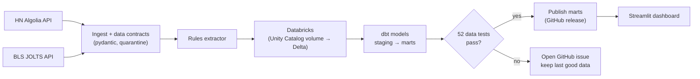

# Hiring Market Pulse

[](https://github.com/wacsvn/hiring-market-pulse/actions/workflows/ci.yml)
[](https://github.com/wacsvn/hiring-market-pulse/actions/workflows/refresh.yml)

A tested data pipeline and dashboard that turns three years of Hacker News **"Who is
hiring?"** threads (11,500+ job posts) into a picture of the tech job market, then
checks that picture against official U.S. labor statistics (BLS JOLTS).

The point of the project is less the charts than the machinery behind them: data
contracts at the door, 52 automated data tests, and a mutation check that proves those
tests actually catch bad data. Publishing is gated, so nothing reaches the dashboard
unless every hard check passes.


## What the data says

Comparing November 2023 with September 2026 (the latest complete month):

- **Pay transparency more than doubled.** 13% of posts listed a salary, now 31%. The
  median posted salary went from $160k to $192k (USD annual ranges only).
- **Remote is giving ground, slowly.** Remote-friendly posts fell from 61% to 51%,
  while onsite-only rose from 15% to 25%.
- **AI is the fastest-rising skill mention.** Posts mentioning LLMs/GenAI went from 8% to
  15% (first vs last six months). Postgres, TypeScript and Python also climbed; Vue,
  Django and C++ declined.
- **HN is not a stand-in for the official numbers.** Over the same window, BLS job
  openings in the Information sector fell 35% (first vs last six months), while HN post
  volume fell only 6%. Month-to-month the two are weakly related (|r| < 0.5 at every lag
  from -3 to +3 months), so HN reads as a view of startup and engineering demand, not of
  the sector as a whole.


## How it works



1. **Ingest:** `pulse ingest` pulls each monthly thread and the JOLTS series. Every
   record is validated against a [pydantic contract](src/pulse/contracts.py); failures
   go to a quarantine table with the reason instead of disappearing.
2. **Extract:** a deterministic [rules extractor](src/pulse/extract/rules.py) pulls work
   mode, salary, role, seniority, location, and tech stack out of free-text posts.
3. **Load:** parquet goes to a Databricks volume and becomes Delta tables
   (`read_files`), with schema-drift capture.
4. **Model:** [dbt](dbt/models) builds staging views and marts: monthly KPIs, role mix,
   tech trends, salary bands, and the HN-vs-JOLTS comparison.
5. **Test and publish:** the daily [refresh workflow](.github/workflows/refresh.yml)
   publishes the marts only if `dbt build` passes; otherwise it opens an issue.
6. **Present:** the [Streamlit app](app/streamlit_app.py) reads the published marts and
   shows its own data-quality status ("51 of 52 checks passed").

## How quality is enforced

| Layer | What runs | Where |
|---|---|---|
| Inputs | Data contracts on every record; quarantine with reasons; quarantine-rate limit | [`contracts.py`](src/pulse/contracts.py), [dbt test](dbt/tests/assert_quarantine_rate_below_5pct.sql) |
| Python | 64 pytest tests on recorded API responses, incl. property-based salary parsing | [`tests/`](tests) |
| Data | 52 dbt tests: uniqueness, relationships, accepted values, salary rules, no missing months, freshness, schema drift, cross-source divergence (warn) | [`dbt/`](dbt) |
| Data tests themselves | Mutation check: corrupts a copy of the data 11 ways; each matching test must fail (11/11) | [`dbt_mutation_check.py`](scripts/dbt_mutation_check.py) |
| Dashboard | 11 Playwright tests against frozen fixture data: KPIs, filters, chart contents, color stability, empty state | [`e2e/`](e2e) |
| CI | Lint, types, tests, dbt in per-PR Databricks schemas (always dropped), e2e; mutation check when data tests change | [`.github/workflows/`](.github/workflows) |

### Tests that can fail

A test that can't fail is worse than no test, because it reports safety that isn't
there. This project started from exactly that bug: an earlier browser-automation
exercise checked that a list was sorted by timestamp, but the timestamps never parsed,
every comparison was against `NaN`, and the check passed no matter what. So every check
here has to be shown to fail:

- **Data tests:** the mutation check injects duplicates, inverted salary ranges, gaps in
  the JOLTS series, backdated posts, schema drift, a collapsed fetch, and a quarantine
  spike. It requires the specific test meant for each one to fail.
- **UI tests:** sabotaging the app (adding the incomplete month back onto a trend line,
  or coloring series by position) makes the matching Playwright test fail.
- **Tooling:** the CI script that keeps a blocklist of words out of the repo initially
  reported "clean" when `git grep` errored. It now treats errors as failures and refuses
  to run without a pattern.

Bugs these checks caught during development:

- A DECIMAL rounding issue that made work-mode shares add up to 1.00001.
- A blind spot in a data test. A month whose fetch returned zero posts vanished from the
  monthly table, so the "posts per month in range" check had nothing to flag. The
  mutation check exposed it, and the test now counts from the threads.
- Plural job titles ("Software Engineers") missed by the role extractor.
- "go" the verb counted as the Go language.
- Test fixtures that breached the pipeline's own quarantine limit.

## Run it locally

Requires Python 3.12 with [uv](https://docs.astral.sh/uv/), and Node 22 for the e2e tests.

```bash
uv sync --all-extras
uv run pytest                                    # unit + contract tests (offline)

# Dashboard on the bundled fixture data
PULSE_MARTS_DIR=tests/fixtures/marts uv run streamlit run app/streamlit_app.py

# Dashboard e2e tests
cd e2e && npm ci && npx playwright install chromium && npx playwright test
```

Full pipeline (needs a Databricks SQL warehouse; set `DATABRICKS_HOST`,
`DATABRICKS_HTTP_PATH`, `DATABRICKS_TOKEN`):

```bash
uv run pulse ingest --months 36
uv run pulse extract
uv run pulse load-warehouse --raw-schema pulse_raw
cd dbt && uv run dbt deps && PULSE_RAW_SCHEMA=pulse_raw DBT_SCHEMA=pulse uv run dbt build && cd ..
uv run pulse export-marts --schema pulse --out data/marts --dbt-results dbt/target/run_results.json
uv run streamlit run app/streamlit_app.py
```

## Repository map

```
src/pulse/        ingestion, contracts, extraction, warehouse load, analysis helpers
dbt/              staging + mart models, schema tests, singular business-rule tests
app/              Streamlit dashboard (charts.py follows a validated, colorblind-safe palette)
e2e/              Playwright tests for the dashboard
tests/            pytest suite and recorded API fixtures
scripts/          fixture recording, mutation check, scrub check, failure reporting
.github/workflows CI, daily refresh, mutation check
```

## Limitations

- HN skews toward startups and software roles, and one post can cover many openings.
  Read the trends as signals about that slice of the market.
- The rules extractor misses things. Seniority is the weakest field: many posts don't
  state a level, and the "Level not stated" salary band is often higher than "Senior".
- Salaries are posted ranges, not offers, and only USD annual figures feed the medians.
- JOLTS is published with about a two-month lag, and its newest month is preliminary.

## Roadmap

- LLM extraction (local model by default) scored against a hand-labeled set, with CI
  failing if accuracy drops below the committed baseline.
- Visual regression and accessibility checks, a test-health page built from CI
  results, and published dbt docs.
- A Tableau Public companion workbook and a written analysis notebook.
